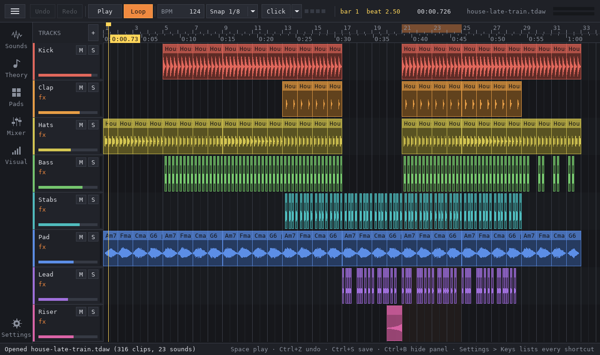

# tinydaw

A small music maker for Windows and Linux. Make drums, synth sounds and chords, arrange them on a
timeline, mix them with effects and export a finished song. You can also play sounds live from
your computer keyboard, a game controller or a MIDI keyboard, and record what you play.



- **Starts you off quickly:** three example songs, 30 ready-made drum beats, and a Theory panel
  with scales, chords and progressions you can add to your song with one click.
- **Makes its own sounds:** sine, square, saw, triangle and noise tones, kicks, snares and hats.
  It can also bring in WAV, FLAC, OGG and MP3 files.
- **A real mixer:** per-track filter, EQ, drive, pan and sidechain ducking, plus delay and reverb.
- **Live play:** 16 pads and a MIDI instrument, with recording onto the timeline.
- **Exports** to WAV, AIFF, FLAC, OGG, Opus or MP3, as a full mix or as one file per track.
- **Looks how you like:** Dark, Light, follow-your-desktop, Windows XP, Frutiger Aero and Blender themes.

## Get it

**Windows:** download `tinydaw-<version>-windows-x64.zip` from the
[latest release](https://github.com/WaywardSkylark/tinydaw/releases/latest), unzip it anywhere and
run `tinydaw.exe`. Nothing is installed.

**Linux:** install the libraries and build:

```sh
# Arch / CachyOS
sudo pacman -S sdl2-compat sdl2_ttf libsndfile libsamplerate alsa-lib ttf-dejavu zenity
# Debian / Ubuntu
sudo apt install libsdl2-dev libsdl2-ttf-dev libsndfile1-dev libsamplerate0-dev libasound2-dev fonts-dejavu-core zenity

make
./tinydaw
```

`zenity` gives the Open and Save dialogs. Without alsa-lib tinydaw still builds, just without MIDI.

## Your first minute

1. **Hear what it can do:** ☰ > **Open an example song**, then press **Space**. Each example opens
   as an untitled copy, so you can change anything without spoiling it.
2. **Start your own:** ☰ > **New**. Open **Theory** on the left, pick a **Style** under Beats and
   press **Place on new row(s)**.
3. **Add harmony:** in Theory > **Keys**, pick a key, then press **Place** next to a chord
   progression (or **+** to put its chords in your library).
4. **Add your own sounds:** **Sounds > New sound**, choose a wave and a note, press
   **+ Add to library**, then drag it from the library onto a track.
5. **Mix it:** open **Mixer**, click a track's name and try a filter, some reverb, or **Duck** to
   make it pump with the kick.
6. **Save** with Ctrl+S and **export** with Ctrl+E.

Settings > **Keys** lists every shortcut.

## Finding your way around

- **Top bar:**
  - the ☰ menu: new, open, save, examples, export, settings, full-screen show, quit
  - undo and redo
  - play and loop
  - tempo, snap and the metronome
  - where you are in the song, and the master level
- **The rail** down the left holds Sounds, Theory, Pads, Mixer, Visual and Settings. Each opens a
  panel with its own tabs. Click the open one again, or press **Ctrl+B**, to hide it and give the
  timeline the full width. **Ctrl+1** to **Ctrl+6** open them from the keyboard.
- **The timeline:** tracks down the side, bars and minutes:seconds along the top.

## Arranging

| To | Do this |
|---|---|
| Play / stop | Space, or **Play**. Home goes to the start, End to the end |
| Put a sound in the song | Drag it from the library onto a track |
| Hear a sound first | Click it in the library (click again to stop) |
| Move a clip | Drag it, in time and between tracks. Arrow keys nudge it |
| Trim a clip | Drag its left or right edge |
| Fade a clip | Drag the small squares on its top corners |
| Make a clip louder or quieter | Alt + mouse wheel over it |
| Transpose / reverse a clip | `[` and `]` move it a semitone, Ctrl+R plays it backwards |
| Select several | Drag a box over empty timeline, Shift+click to add or remove, Ctrl+A for all, Esc for none. Moves, deletes, copies, transposes and gain changes then apply to all of them |
| Copy | Ctrl+drag, Ctrl+D (a copy straight after), or Ctrl+C / Ctrl+X then Ctrl+V (pastes at the playhead) |
| Delete | Delete, or right-click a clip |
| Undo / redo | Ctrl+Z, Ctrl+Shift+Z (300 steps) |
| Loop part of the song | Right-drag in the ruler, then **Loop** or L |
| Snap to the grid | **Snap** steps through off, bar, 1/2 … 1/16; its arrow opens the list. Hold Shift while dragging to ignore it |
| Jump around | Ctrl+←/→ a bar, Ctrl+Shift+←/→ a beat, Alt+←/→ to the next clip edge, F shows the playhead, Z zooms to fit the song |
| Zoom / scroll | Ctrl + wheel to zoom, wheel to scroll, + and - also zoom |
| Change any number | Click it and type, or drag it, or use the wheel (Shift for fine steps) |
| Tempo | Click **BPM** and type, or use the metronome menu (±1, half, double, tap tempo with T) |
| Metronome | **Click** in the top bar, or M. Its arrow sets the sound, 8th/16th ticks, accent and a 1-2 bar count-in |
| Add a track | **+** next to TRACKS (up to 16). Each track has mute, solo and volume |
| Bring in audio | Drop WAV, FLAC, OGG or MP3 files on the window |

## Making sounds

**Sounds** has your library and **New sound**: choose sine, square, saw, triangle, noise, kick,
snare or hat. Then set the note, length, volume and envelope (attack, release), and the tuning (A4,
415–466 Hz). Pitched and reversed copies made for clips stay out of the library list.

**Theory** has four tabs. Everything you can hear in them has a **+** that adds it to the library.
The strip at the top of each tab sets which wave and length those sounds use. Adding the same thing
twice doesn't make a copy, and the Sounds button counts what you've added.

| Tab | What's there |
|---|---|
| Beats | 30 styles: house, deep house, tech house, techno, trance, UK garage, breakbeat, drum & bass, jungle, dubstep, hip-hop, trap, UK drill, phonk, R&B, pop, rock, funk, disco, synthwave, electro, footwork, lo-fi, reggaeton, dancehall, reggae, afrobeats, amapiano, bossa nova and jazz swing. Each has its own tempo, swing, key and drum kit, and a step grid you can edit. **Play** previews it, **+ Library** adds it as a loop, **Place** puts it in the song, or drag the orange bar onto any track |
| Keys | Any key and 12 scales and modes: the notes, the chords of the key (triads or 7ths, with Roman numerals) and 12 common progressions to play, add or place |
| Chords | 19 chord types on the chosen root |
| Reference | The circle of fifths, intervals (with their just-intonation ratios), tempo maths (delay times in ms), and the frequency of every note |

## Mixing

**Mixer** (or F3) has four pages:

| Page | What's there |
|---|---|
| Clip | Gain, pitch, fades and reverse for the selected clips |
| Track | Volume, pan, a filter (low-, high- or band-pass with cutoff and resonance), 3-band EQ, drive, how much it ducks, and how much it sends to the delay and reverb |
| Effects | The delay (in time with the tempo, 1/16 to 1/2 including dotted and triplet, feedback, tone, ping-pong), the reverb (size, damping) and the sidechain: which track makes the others duck, and how fast they recover |
| Live | How far the MIDI pitch wheel bends; the mod wheel opens the filter on the instrument's track |

Tracks with effects show `fx` under their name, and every track has a level meter. What you export
sounds exactly like what you hear, including the delay and reverb dying away after the last note.

## Playing live: pads and MIDI

**Pads** (or F2) has 16 pads. Drag library sounds onto them, or press **Fill from library**.

- **Playing them:** keys 1-4, Q-R, A-F and Z-V (while the panel is open), a game-controller button,
  a MIDI note, or a click.
- **Modes:** **One-shot** plays to the end, **Hold** plays while you hold it, **Loop** starts and
  stops on each press.
- **Rebinding:** select a pad, press **Learn input**, then press any key, controller button, stick,
  trigger, MIDI note or knob.
- **Instrument:** a MIDI keyboard plays a chosen sound at every pitch. On a piano keyboard, press
  **Stop MIDI notes triggering pads** in Settings > Input so every key plays the instrument.
- **Recording:** turn on **Rec**, play the song and play along. Hits become clips, snapped to the
  grid, and a count-in can play first.

Controllers and MIDI devices are picked up when they're plugged in, even while tinydaw is running.
Pads play through their track's effects.

## Saving and exporting

Projects are small `.tdaw` files, saved in `Music/tinydaw` by default. They store how each sound was
made rather than the audio, so they open at full quality at any sample rate. Imported audio files
are linked, not copied; if one moves, its clips play silence until it's back.

Unsaved work is autosaved every 30 seconds; after a crash, ☰ > **Recover unsaved work** brings it
back. Projects also open by dropping them on the window or naming them on the command line.

**Export** (Ctrl+E):

| Option | Choices |
|---|---|
| Format | WAV, AIFF, FLAC, OGG Vorbis, Opus, MP3 |
| Bit depth | 16-bit, 24-bit, 32-bit float (FLAC up to 24-bit; lossy formats have a quality setting instead) |
| Sample rate | The project's, or 44.1–192 kHz (Opus is always 48 kHz, MP3 at most 48 kHz) |
| Channels | Stereo or mono |
| Range | The whole song or the loop |
| Output | The mix, or one file per track |
| Normalize | Off, -1 dB, -0.1 dB |
| Dither | For 16-bit files |

Exports go to your Music folder.

## Watching it: the visualizer

**Visual** (or F4) has a spectrum analyzer, a waveform, a stereo view (with a warning when left and
right would cancel in mono) and level meters with clip warnings.

**F11** starts a full-screen show: a glowing blob for every track that's playing, in its colour,
circling in time with the song. They swell on the kick, a ring of spectrum bars pulses around
them, and every beat sends out a ripple. Space plays, the pad keys still work, and Esc leaves.

## The example songs

| Song | What's in it |
|---|---|
| House: Late Train | 124 BPM, A minor. Four-on-the-floor drums, an off-beat bass and chord stabs that pump with the kick, a pad, a lead with ping-pong delay, and a riser and snare roll into the drop |
| Hip-hop: Corner Store | 88 BPM, D minor. Swung boom-bap drums, an 808-style bass, soft keys (Dm9, Gm7, Bbmaj7, A7), a bell melody and tape hiss |
| Experimental: Glass Weather | 96 BPM, F Lydian. Resonant drones, glass bells falling five against four into long echoes, reversed bells, wind, and drums that loop every 3.5 beats so they drift against the bar |

Each sets up the pads with its own sounds too. `examples/make_examples.py` writes them.

## Settings

- **Look:** Dark, Light, System (follows your desktop's dark/light setting), Windows XP, Frutiger
  Aero or Blender.
- **Audio:** output device, the project's sample rate (44.1 to 192 kHz) and master volume.
- **Input:** connected controllers and MIDI devices, and MIDI options.
- **Keys:** every shortcut.
- **About:** the version, and where projects, pad bindings and autosaves are kept.

Your theme, output device, metronome and pad bindings are remembered: in `~/.config/tinydaw/` on
Linux and `%APPDATA%\tinydaw` on Windows.

## Command line

```sh
./tinydaw song.tdaw                       # open a project
./tinydaw a.wav b.flac                    # start with these in the library
./tinydaw --demo                          # a two-bar beat to play with
./tinydaw --beat trap --export trap.wav   # render a genre beat (4 bars, its tempo and key)
./tinydaw song.tdaw --export song.flac --bits 24 --rate 96000
./tinydaw --demo --save demo.tdaw         # write a project without opening a window
./tinydaw --version
```

`./tinydaw --help` lists every option.

## Limits

tinydaw has no automation (effect settings stay the same for the whole song), no MIDI output, no
recording from a microphone, and no time-stretching. Its drum patterns are approximations of each
style, meant as a starting point.

## For developers

**Layout of the code:**
- `src/main.c`: the interface, drawn fresh every frame with SDL's 2D renderer, and the self-tests
- `src/audio.c`: sounds, synthesis, import, sample-rate changes, export
- `src/fx.c`: the mixer and effects: a state-variable filter, RBJ biquad EQ, tanh drive, a tempo-synced
  delay and a Freeverb-style reverb
- `src/analysis.c`: the FFT behind the analyzer and the show
- `src/project.c`: the `.tdaw` format
- `src/midi.c`: MIDI input (ALSA on Linux, winmm on Windows)
- `src/theory.c`: scales, chords, progressions and the beat styles
- `src/compat.h`: the few things that differ on Windows

**How some of it works:**
- The audio callback runs on SDL's audio thread, and every edit takes the audio device lock.
- Undo compares the project with a snapshot after every frame, so no edit can forget to record itself.
- Sounds are mixed in 32-bit float at the project rate. Changing the rate rebuilds synthesized sounds
  and reloads imported ones at the new rate, rather than resampling them.

**Tests:**

```sh
./tinydaw --selftest                      # 150+ checks, driving the real interface with simulated input
./tinydaw --demo --screenshot ui.bmp      # draw the window off-screen
TINYDAW_DEBUG_INPUT=1 ./tinydaw           # print every key, controller and MIDI input
```

The self-test covers editing, undo, saving and reopening sound for sound, pads, MIDI and controller
input, every effect measured on rendered audio, the analyzer, the metronome, the themes and the
example songs.

**Windows builds** are cross-compiled on Linux with llvm-mingw against MSYS2's libraries:
`make dist-windows`, see [win/README.md](win/README.md). The version lives in `VERSION`, and the
program, saved projects, the Windows file properties and the zip name all use it.

**Built with** SDL2 and SDL2_ttf (zlib licence), libsndfile and alsa-lib (LGPL-2.1), libsamplerate
(BSD-2) and the DejaVu fonts. The Windows zip includes their licences.
